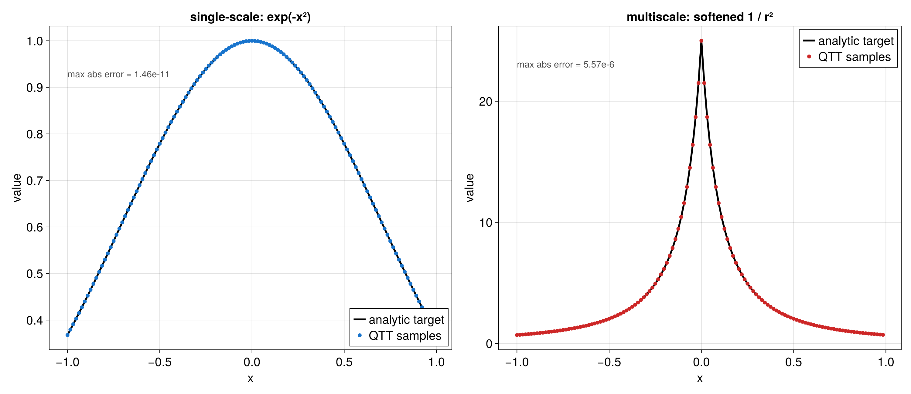
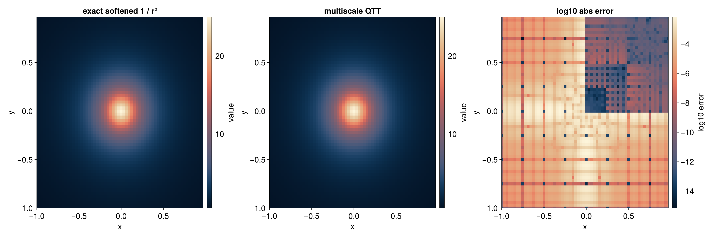
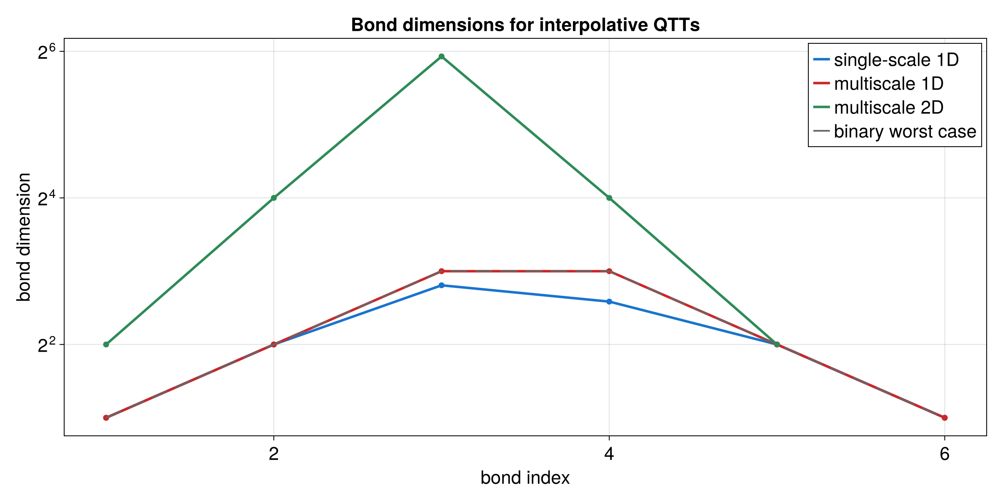

# Interpolative QTT

Interpolative QTT builds a tensor train by sampling a function through local
Chebyshev-Lobatto interpolation. This is useful when the function is already
given on a physical interval and known nonsmooth or sharply localized points
should stay on a multiscale refinement path.

Runnable source: [`docs/tutorial-code/src/bin/interpolative_qtt.rs`](../../../../tutorial-code/src/bin/interpolative_qtt.rs)

## Key API Pieces

Use `interpolate_single_scale` for a smooth one-dimensional function on one
interval. The result is a binary `SimpleTensorTrain`, so the site index `[0, 0, ...]`
evaluates the left endpoint of the sampled interval.

```rust
# fn main() -> anyhow::Result<()> {
use tensor4all_interpolativeqtt::{
    interpolate_single_scale, AbstractTensorTrain, InterpolativeQttOptions,
};

let options = InterpolativeQttOptions::default().with_tolerance(1e-12);
let tt = interpolate_single_scale(
    |x| (-x * x).exp(),
    -1.0,
    1.0,
    5,
    12,
    &options,
)?;

let value = tt.evaluate(&[0, 0, 0, 0, 0])?;
assert!((value - (-1.0_f64).exp()).abs() < 1e-10);
# Ok(())
# }
```

Use `interpolate_multi_scale` when a known location should remain refined. The
following target is a finite, softened version of `1 / r^2`; the point `x = 0`
is still the sharp feature.

```rust
# fn main() -> anyhow::Result<()> {
use tensor4all_interpolativeqtt::{
    interpolate_multi_scale, AbstractTensorTrain, InterpolativeQttOptions,
};

let epsilon = 0.2_f64;
let inverse_square = |x: f64| 1.0 / (x.abs() + epsilon).powi(2);
let options = InterpolativeQttOptions::default().with_tolerance(1e-12);
let tt = interpolate_multi_scale(
    inverse_square,
    -1.0,
    1.0,
    5,
    16,
    &[0.0],
    &options,
)?;

let value = tt.evaluate(&[0, 0, 0, 0, 0])?;
assert!((value - inverse_square(-1.0)).abs() < 1e-8);
# Ok(())
# }
```

The multidimensional constructor fuses all variables at the same bit level. For
two variables each site has dimension `4`, corresponding to the two binary
digits at that level.

```rust
# fn main() -> anyhow::Result<()> {
use tensor4all_interpolativeqtt::{
    interpolate_multi_scale_nd, AbstractTensorTrain, InterpolativeQttOptions,
};

let epsilon = 0.2_f64;
let radial_inverse_square = |x: &[f64]| {
    1.0 / (x[0] * x[0] + x[1] * x[1] + epsilon * epsilon)
};
let options = InterpolativeQttOptions::default().with_tolerance(1e-12);
let tt = interpolate_multi_scale_nd(
    radial_inverse_square,
    &[-1.0, -1.0],
    &[1.0, 1.0],
    4,
    8,
    &[vec![0.0, 0.0]],
    &options,
)?;

assert_eq!(tt.site_dims(), vec![4, 4, 4, 4]);
let value = tt.evaluate(&[0, 0, 0, 0])?;
assert!((value - radial_inverse_square(&[-1.0, -1.0])).abs() < 1e-8);
# Ok(())
# }
```

The tutorial binary runs these three constructions and writes CSV output for
the plots below.

## What It Computes

The first example uses single-scale interpolation for `exp(-x^2)`. The second
uses multiscale interpolation for a softened one-dimensional inverse-square
profile, keeping the origin on the refinement path.



The third example uses `interpolate_multi_scale_nd` for a two-dimensional
softened radial inverse-square profile. The error plot uses `log10` absolute
error so both the peak and the background remain visible.



The final plot compares the bond dimensions for all three examples. The
multiscale cases need larger internal spaces near the refined point, and the
two-dimensional fused sites are more expensive than the one-dimensional sites.



## Independent dyadic patches

`interpolate_patched_nd` constructs separate boxes instead of refining inside a
single train. Its evaluator receives column-major `[D, n_points]` coordinates
and a serial execution token. Real and complex values use the same API. Each
accepted `InterpolativePatch` contains the fixed leading bits of each axis, a
QTT over the remaining bits, and an absolute local error estimate.

The [patched tutorial source](../../../../tutorial-code/src/bin/patched_interpolative_qtt.rs)
constructs a complex two-dimensional Green's function, converts the patches to
`PartitionedTreeTN`, and checks the patched Fourier transform against a
sixteen-point direct DFT. Run it with
`cargo run -p tensor4all-tutorial-code --bin patched_interpolative_qtt`.

```rust
# fn main() -> Result<(), Box<dyn std::error::Error>> {
# use std::convert::Infallible;
# use num_complex::Complex64;
# use tensor4all_interpolativeqtt::{interpolate_patched_nd, PatchedInterpolativeOptions};
# fn green(point: &[f64]) -> Complex64 {
#     let energy = (2.0 * std::f64::consts::PI * point[0]).cos()
#         + (2.0 * std::f64::consts::PI * point[1]).cos();
#     Complex64::new(1.0, 0.0) / Complex64::new(0.2 - energy, 0.1)
# }
{{#include ../../../../tutorial-code/src/bin/patched_interpolative_qtt.rs:construction}}
# Ok(())
# }
```

A box splits when its checked Chebyshev residual plus SVD truncation bound
exceeds `tolerance`, or its compressed rank exceeds `max_bond_dim`. With one
site left it is sampled exactly. Hitting `max_depth` or `max_patches` produces
an error. Validation samples can miss an arbitrary feature, so this is an error
estimate rather than a rigorous certificate for unsampled points.

Every local site fuses one bit per axis, with axis zero varying fastest. For
conversion, the tutorial uses `tensor_train_to_treetn_with_names`, inserts
one-hot prefix sites, unfuses with `LinearizationOrder::ColumnMajor`, and calls
`TreeTN::split_to`. All physical sites must exist before `SubDomainTreeTN::new`
applies the prefix projector.

For thread parallelism, enable `parallel` and call
`interpolate_patched_nd_on_lanes` with caller-owned `hataori_tenferro::TenferroLanes`.
Choose P engines of B threads each explicitly. Evaluator batches receive the
executing engine's `Exec` token: ignore it for serial callbacks, use
`for_ranges`/`fork`, or call external libraries inside `external`. Algebra and
compression use the same lane engine; narrow waves leave lanes idle. Keep the
callback pure and independent of thread count. Patches are merged and returned
in canonical prefix order. The feature selects faer; on macOS disable default
features to avoid combining it with Accelerate. BLAS plus `parallel` is rejected.
